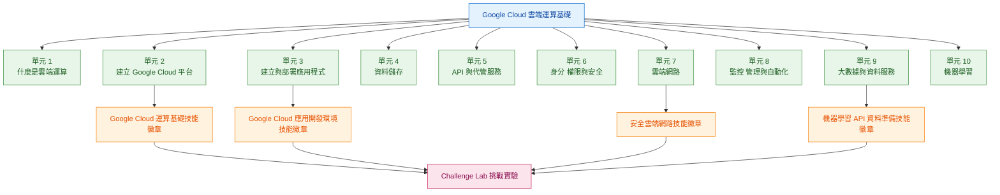

# Google Cloud 雲端運算基礎課程導覽

課程計畫網址：[Google 數位人才探索計畫](https://growonairtw.withgoogle.com/events/digitaleducation?gad_source=1&gad_campaignid=24068416008&gbraid=0AAAAAo-gIdOfvnpv0d0Lu77Zb8EaPNigE&gclid=CjwKCAjwyuDTBhB-EiwANCQhLHoF4OiUE7dkC5I6ptcovi63Qi5TzSbq0MHrWqkiKV0LaYj19oUa_BoCtbgQAvD_BwE)

> 預估閱讀時間：約 2 分鐘

---

## 這門課學什麼？


課程重點不是一開始記住大量 Google Cloud 服務，而是先建立完整的 **Cloud Computing｜雲端運算** 基礎地圖。

內容涵蓋：

* 雲端運算基本概念
* Google Cloud 平台操作
* 應用程式部署
* 資料儲存
* API 串接
* 權限與安全管理
* 雲端網路
* 系統監控
* 大數據處理
* 機器學習

:::info 學習主線

雲端基礎
→ Google Cloud 平台
→ 應用程式
→ 資料儲存
→ API
→ 資訊安全
→ 雲端網路
→ 系統維運
→ 大數據
→ 機器學習
:::
---

## GCP 核心地圖

整門課可以濃縮成八個核心領域：

| 英文                   | 中文     | 核心問題          |
| -------------------- | ------ | ------------- |
| **Compute**          | 運算     | 程式在哪裡執行       |
| **Storage**          | 儲存     | 資料放在哪裡        |
| **API**              | 應用程式介面 | 系統之間如何溝通      |
| **Security**         | 資訊安全   | 誰可以存取哪些資源     |
| **Network**          | 網路     | 雲端服務之間如何連線    |
| **Operations**       | 維運     | 如何監控、管理與自動化系統 |
| **Data**             | 資料     | 如何處理與分析大量資料   |
| **Machine Learning** | 機器學習   | 如何利用資料進行預測與判斷 |

學到新的 Google Cloud 服務時，可以先判斷：

> **這個服務屬於運算、儲存、網路、安全、資料，還是哪一層？**

用分類建立系統觀，比單獨記住每個產品更容易理解。

---

# 10 個課程 Module｜課程單元

| Module                                     | 中文主題                   | 核心概念                                           |
| ------------------------------------------ | ---------------------- | ---------------------------------------------- |
| **1. So What's the Cloud Anyway?**         | 到底什麼是雲端運算？             | Cloud Computing｜雲端運算基本概念                       |
| **2. Start with a Solid Platform**         | 建立穩固的雲端平台              | Google Cloud 平台與基本操作                           |
| **3. Use Google Cloud to Build Your Apps** | 使用 Google Cloud 建立應用程式 | Compute｜運算、Serverless｜無伺服器運算、應用部署              |
| **4. Where Do I Store This Stuff?**        | 資料要存在哪裡？               | Structured Data｜結構化資料、Unstructured Data｜非結構化資料 |
| **5. There's an API for That**             | API 與代管服務              | API｜應用程式介面、Managed Services｜代管服務               |
| **6. You Can't Secure the Cloud, Right?**  | Google Cloud 雲端安全      | Identity｜身分、Permission｜權限、Security｜安全          |
| **7. It Helps to Network**                 | Google Cloud 雲端網路      | Cloud Network｜雲端網路與安全連線                        |
| **8. Keeping an Eye on Things**            | 監控、管理與自動化              | Monitoring｜監控、Management｜管理、Automation｜自動化     |
| **9. You Have the Data...**                | 大數據與資料服務               | Big Data｜大數據與 Google Cloud 資料服務                |
| **10. Let Machines Do the Work**           | 機器學習                   | Machine Learning｜機器學習基礎                        |

---

## Mermaid｜Google Cloud 課程總覽



課程順序可以理解成：

> **先建立雲端觀念，再進入運算、應用、儲存、API、安全、網路、維運、資料與機器學習。**

---

# Hands-on Labs｜動手實作實驗

課程不只有影片，也包含真正的 Google Cloud 操作。

* **24 個 Hands-on Labs｜動手實作實驗**
* **4 個 Challenge Labs｜挑戰實驗**
* 約 **24 小時實作**

Lab 透過 **Google Skills** 提供實際的 **Google Cloud Environment｜Google Cloud 雲端環境**。

---

## Lab 操作流程

```text
開始 Lab
↓
取得 Temporary Account 臨時帳號
↓
登入 Google Cloud Console 雲端管理主控台
↓
按照 Lab 指示操作資源
↓
完成 Lab
↓
Sign Out 登出
↓
End Lab 結束實驗
```

可以理解成：

> Google 提供一個暫時的 GCP 練習環境，供課程實際操作。

:::warning Lab 注意事項

Lab 使用 **Temporary Google Account｜臨時 Google 帳號**。

不要：

* 修改 Recovery Information｜帳號復原資訊
* 使用自己的 Google Account 取代 Lab Account
* 在 Lab 結束後繼續使用臨時帳號

:::

---

# Skill Badge｜技能徽章

Skill Badge 代表完成特定主題的一組 Google Cloud 實作任務。

課程包含四個 Skill Badges：

## 1. Basics of Google Cloud Compute

**Google Cloud 運算基礎**

* Compute｜運算資源
* Virtual Machine｜虛擬機器
* Google Cloud 基礎運算服務

## 2. Set Up an App Dev Environment on Google Cloud

**在 Google Cloud 建立應用程式開發環境**

* Application Development｜應用程式開發
* Cloud Development Environment｜雲端開發環境
* Application Deployment｜應用程式部署

## 3. Build a Secure Google Cloud Network

**建立安全的 Google Cloud 網路**

* Cloud Network｜雲端網路
* Network Security｜網路安全
* Access Control｜存取控制

## 4. Prepare Data for ML APIs on Google Cloud

**為 Google Cloud 機器學習 API 準備資料**

* Data Preparation｜資料準備
* Machine Learning API｜機器學習 API
* Google Cloud Data Services｜資料服務

---

# Challenge Lab｜挑戰實驗

一般 **Hands-on Lab｜動手實作實驗** 會提供較完整的操作步驟。

**Challenge Lab｜挑戰實驗** 則需要自行判斷：

* 使用哪個 Google Cloud Service｜Google Cloud 服務
* 建立哪些 Resource｜資源
* 操作與設定順序
* 如何完成指定結果

學習流程可以整理成：

```text
課程影片
↓
理解概念
↓
Hands-on Lab 動手練習
↓
Skill Badge 技能徽章
↓
Challenge Lab 挑戰實驗
↓
確認是否真正理解與操作
```

---

# 課程 TODO

| 狀態 | Module | 中文主題      | 學習重點                         |
| -- | ------ | --------- | ---------------------------- |
| ⬜  | 1      | 什麼是雲端運算   | Cloud Computing｜雲端運算         |
| ⬜  | 2      | 建立穩固的雲端平台 | Google Cloud 基本操作            |
| ⬜  | 3      | 建立應用程式    | Compute｜運算、Serverless｜無伺服器運算 |
| ⬜  | 4      | 資料儲存      | 結構化與非結構化資料                   |
| ⬜  | 5      | API 與代管服務 | API、Managed Services｜代管服務    |
| ⬜  | 6      | 雲端安全      | Identity｜身分、Permission｜權限    |
| ⬜  | 7      | 雲端網路      | Cloud Network｜雲端網路           |
| ⬜  | 8      | 監控、管理與自動化 | Monitoring｜監控、Automation｜自動化 |
| ⬜  | 9      | 大數據服務     | Big Data｜大數據                 |
| ⬜  | 10     | 機器學習      | Machine Learning｜機器學習        |

---

# 實作 TODO

| 狀態 | 任務                        | 完成目標                     |
| -- | ------------------------- | ------------------------ |
| ⬜  | Hands-on Labs｜動手實作實驗      | 完成 24 個 Lab              |
| ⬜  | Skill Badge｜技能徽章 1        | Google Cloud 運算基礎        |
| ⬜  | Skill Badge｜技能徽章 2        | 建立 Google Cloud 應用程式開發環境 |
| ⬜  | Skill Badge｜技能徽章 3        | 建立安全的 Google Cloud 網路    |
| ⬜  | Skill Badge｜技能徽章 4        | 為機器學習 API 準備資料           |
| ⬜  | Challenge Labs｜挑戰實驗       | 完成 4 個 Challenge Lab     |
| ⬜  | Knowledge Assessment｜知識評量 | 完成課程知識評量                 |

---

# 複習重點

整門 **Google Cloud Computing Foundations｜Google Cloud 雲端運算基礎** 可以先記住這條主線：

> **雲端概念 → 平台 → 應用程式 → 儲存 → API → 安全 → 網路 → 維運 → 資料 → AI 與機器學習**

進一步濃縮：

> **Compute 運算 → Storage 儲存 → API 應用程式介面 → Security 安全 → Network 網路 → Operations 維運 → Data 資料 → Machine Learning 機器學習**

之後每學到一個新的 Google Cloud Service，都可以放回這張架構地圖中，理解它在整個 **Cloud Architecture｜雲端架構** 裡負責的角色。

 
