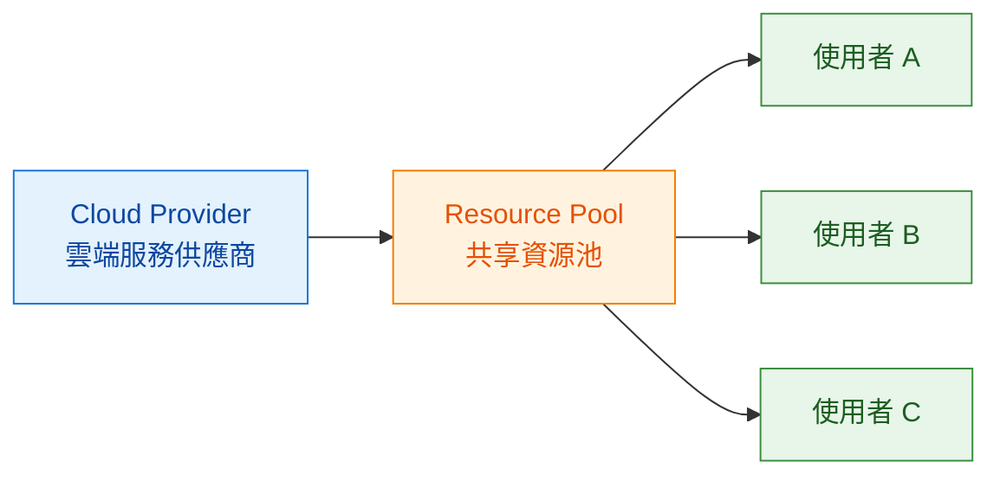
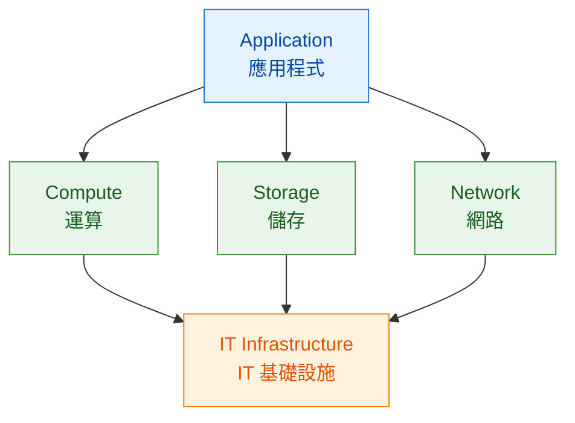

# Module 1｜什麼是 Cloud Computing 雲端運算？

> 預估閱讀時間：約 3 分鐘

## 本篇我要記住

**Cloud Computing｜雲端運算**不只是「把東西放到網路上」。

它的核心是：

> **透過網路隨時取得需要的運算資源，依需求彈性擴縮，並依實際使用量付費。**

:::info 學習主線

需要 IT 資源 → 透過網路取得 → Cloud Provider 雲端服務供應商提供資源 → 動態擴縮 → 按使用量付費
:::
---

## Cloud Computing 雲端運算的 5 個特徵

### 1. On-demand Self-service｜隨需自助服務

需要運算資源時，我可以自己建立，不需要等待人工處理。

例如：

* Compute｜運算資源
* Storage｜儲存資源
* Network｜網路資源

**關鍵：需要就開。**

---

### 2. Broad Network Access｜廣泛網路存取

只要有網路，就可以存取 **Cloud Resources｜雲端資源**。

我不需要人在實體 **Server｜伺服器** 所在的位置。

**關鍵：透過網路使用。**

---

### 3. Resource Pooling｜資源池化

**Cloud Provider｜雲端服務供應商**擁有大量運算資源，再從共同的 **Resource Pool｜資源池** 分配給不同客戶。

因此我通常不需要知道自己實際使用的是哪一台 **Physical Server｜實體伺服器**。

**關鍵：集中大量資源，再依需求分配。**

---

### 4. Rapid Elasticity｜快速彈性伸縮

需求增加：

**增加資源 ↑**

需求下降：

**減少資源 ↓**

例如網站突然出現大量流量，可以快速增加運算資源；流量下降後再縮減。

這就是 **Scale｜擴縮** 的概念。

**關鍵：資源可以跟著需求快速變化。**

---

### 5. Measured Service｜可計量服務

Cloud Computing 通常會記錄實際使用的資源量，並依服務的計費模式收費。

可以先理解成：

> **使用多少資源，就依使用情況支付對應費用。**

因此 Cloud 的重要特色之一，就是不需要像傳統架構一樣，所有硬體都必須事先購買。

**關鍵：Pay for what you use｜依使用量付費。**

---

## Infrastructure｜基礎設施是什麼？

**Infrastructure｜基礎設施**就是：

> **支撐 Application 應用程式正常運作的底層資源與系統。**

課程用「城市」來比喻：

| 城市      | IT 世界                          |
| ------- | ------------------------------ |
| 人       | Users｜使用者                      |
| 車子、建築   | Applications｜應用程式              |
| 道路      | Network｜網路                     |
| 電力、水、通訊 | Infrastructure Services｜基礎設施服務 |

平常我看到的是：

**Website｜網站 / API｜應用程式介面 / App｜應用程式**

但它們底下都需要：

**Compute｜運算 + Storage｜儲存 + Network｜網路**

Google Cloud 提供的許多服務，就是在協助我取得與管理這些 IT Infrastructure。

---

## Cheat Sheet

| 英文名詞                   | 中文名詞   | 我的記法    |
| ---------------------- | ------ | ------- |
| On-demand Self-service | 隨需自助服務 | 需要就開    |
| Broad Network Access   | 廣泛網路存取 | 有網路就能存取 |
| Resource Pooling       | 資源池化   | 集中資源再分配 |
| Rapid Elasticity       | 快速彈性伸縮 | 需求變化就擴縮 |
| Measured Service       | 可計量服務  | 依使用情況計費 |

---

## 最後記住

> **Cloud Computing｜雲端運算 = 透過網路取得共享的 IT 資源，需要時取得、需求改變時彈性擴縮，並依使用情況計費。**
> 

