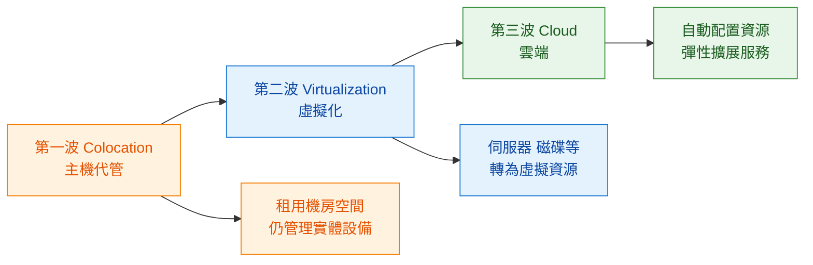
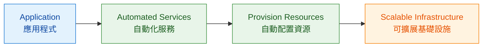

# Module 1｜從實體架構到雲端架構

> 預估閱讀時間：約 3 分鐘

## 本篇我要記住

Cloud Architecture｜雲端架構不是突然出現，而是經歷三個主要階段：

**Colocation｜主機代管 → Virtualization｜虛擬化 → Cloud｜雲端**

核心變化：

> **企業需要自己管理的 Infrastructure｜基礎設施越來越少，自動化程度越來越高。**

---

## 三波架構演進

---

## 第一波 Colocation｜主機代管

早期企業通常需要自己的 **Data Center｜資料中心**。

Colocation｜主機代管的改變：

> **不用自己蓋機房，改成租用別人的機房空間。**

但 Server｜伺服器、Network｜網路等實體設備仍需要企業管理。

---

## 第二波 Virtualization｜虛擬化

實體 Infrastructure｜基礎設施開始轉成 Virtual Resources｜虛擬資源，例如：

* Virtual Server｜虛擬伺服器
* Virtual Disk｜虛擬磁碟
* Virtual Load Balancer｜虛擬負載平衡器

重點：

> **設備被虛擬化，不代表維運工作消失。**

企業仍需要設定、管理與維護這些資源。

---

## 第三波 Cloud｜雲端

Cloud｜雲端進一步加入大量自動化與彈性能力。

Cloud Service｜雲端服務可以進一步自動：

**Provision｜配置 → Configure｜設定 → Scale｜擴展**

因此開發者能把更多注意力放在 Application｜應用程式，而不是底層 Infrastructure｜基礎設施。

---

## 三個階段怎麼分？

| 階段             | 中文   | 核心改變           |
| -------------- | ---- | -------------- |
| Colocation     | 主機代管 | 不自己蓋機房         |
| Virtualization | 虛擬化  | 實體資源轉成虛擬資源     |
| Cloud          | 雲端   | 配置、管理與擴展進一步自動化 |

快速記：

> **租空間 → 虛擬化硬體 → 自動化基礎設施**

---

## 關鍵觀念｜Virtualization 不等於 Cloud

Virtualization｜虛擬化主要解決：

> **實體資源如何變成虛擬資源。**

Cloud｜雲端則更進一步處理：

> **如何自動配置、管理與彈性擴展資源。**

所以：

> **Virtualization ≠ Cloud**

虛擬化是雲端的重要基礎，但兩者不是同一件事。

---

## 補充｜Cloud 背後仍然有實體設備

Cloud 看起來是虛擬的，但底層仍然存在：

**Data Center｜資料中心 → Server｜伺服器 → Network｜網路 → Electricity｜電力**

因此資料中心的能源效率仍然很重要。

這部分記住：

> **Cloud 抽象化了實體 Infrastructure，但實體 Infrastructure 並沒有消失。**

---

## 最後記住

> **Cloud Architecture｜雲端架構的進步，不只是把 Server｜伺服器虛擬化，而是進一步讓 Infrastructure｜基礎設施的配置、管理與擴展自動化。**

---

## Module 1 TODO

| 狀態 | 學習目標                                           |
| -- | ---------------------------------------------- |
| ✅  | Cloud Computing｜雲端運算                           |
| ✅  | IT Infrastructure｜IT 基礎設施                      |
| ✅  | Physical、Virtual、Cloud Architecture｜實體、虛擬與雲端架構 |
| ⬜  | IaaS、PaaS、SaaS｜雲端服務模式                          |
| ⬜  | Google Cloud Compute｜Google Cloud 運算服務         |
| ⬜  | Google Cloud Storage｜Google Cloud 儲存服務         |
| ⬜  | Big Data 與 Machine Learning｜大數據與機器學習           |
| ⬜  | Google Network｜Google 全球網路                     |
| ⬜  | Module 1 Quiz｜單元測驗                             |
