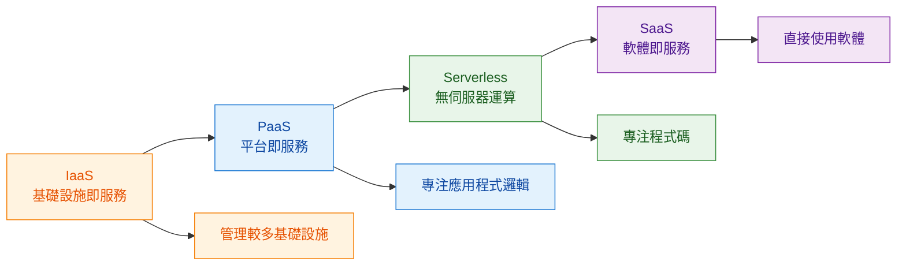
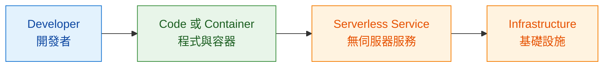
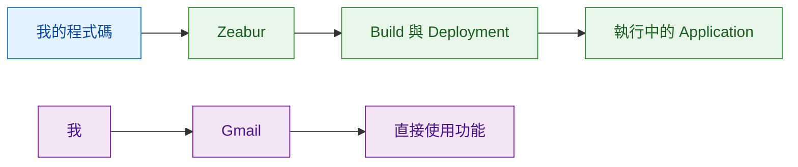

# Module 1｜IaaS、PaaS、SaaS 與 Serverless

> 預估閱讀時間：約 3 分鐘

## 本篇我要記住

IaaS、PaaS、SaaS 最大的差別，可以先不要背定義，而是問：

> **Infrastructure｜基礎設施到底有多少需要我自己管理？**

從 IaaS → PaaS → Serverless → SaaS，我需要管理的底層 Infrastructure 越來越少。

---

## 雲端服務的演進

---

## IaaS｜Infrastructure as a Service｜基礎設施即服務

Cloud Provider 提供最基礎的：

* Compute｜運算
* Storage｜儲存
* Network｜網路

這些原本是 Data Center 裡的實體設備，現在變成可以配置的 Virtual Resources｜虛擬資源。

對我來說可以理解成：

> **Google 給我雲端基礎設施，但我要自己管理比較多東西。**

例如我建立一台 Virtual Machine｜虛擬機器後，Application、環境設定等仍需要自己處理。

---

## PaaS｜Platform as a Service｜平台即服務

PaaS 再幫我處理更多 Infrastructure。

開發者可以把：

**Code｜程式碼 + Platform｜平台提供的環境**

結合起來。

因此我可以把更多注意力放在：

> **Application Logic｜應用程式邏輯**

而不是一直處理底層 Infrastructure。

---

## Serverless｜無伺服器運算

Serverless 又再往前一步。

它不是「世界上沒有 Server」，而是：

> **Server 還存在，只是我不需要負責管理它。**

Google Cloud 的例子：

### Cloud Run｜容器化 Serverless 平台

我準備好 Container｜容器：

**Application → Container → Cloud Run**

Google Cloud 負責底層執行環境與 Infrastructure 管理。

### Cloud Run Functions｜事件驅動無伺服器函式

適合執行 **Event-driven Code｜事件驅動程式碼**。

例如：

**事件發生 → Function 執行 → 完成工作**

並採用 Pay-as-you-go｜按使用量付費。

---

## SaaS｜Software as a Service｜軟體即服務

到了 SaaS，我甚至不是在「部署自己的 Application」。

而是：

> **直接透過 Internet 使用別人已經做好的 Software。**

例如 Google Workspace：

* Gmail
* Google Docs
* Google Drive

我不需要安裝、部署或管理背後的 Infrastructure。

---

## 四個概念怎麼分？

我只要先問自己：

> **這個服務裡，有多少 Infrastructure｜基礎設施需要我自己管理？**

| 模式         | 中文      | 我主要關心什麼           | 我熟悉的例子                         |
| ---------- | ------- | ----------------- | ------------------------------ |
| IaaS       | 基礎設施即服務 | VM 與執行環境          | Google Compute Engine          |
| PaaS       | 平台即服務   | Application Logic | Google App Engine、Zeabur       |
| Serverless | 無伺服器運算  | Code / Container  | Cloud Run、Cloud Run Functions  |
| SaaS       | 軟體即服務   | 直接使用 Software     | Gmail、Google Docs、Google Drive |

---

### 我的快速記法

#### IaaS：給我一台雲端電腦，我自己架

例如：

**Compute Engine → 建立 VM → 設定環境 → 部署 Application**

Cloud Provider 幫我準備運算、儲存、網路等 Infrastructure，但作業系統、Runtime、Application 等仍有很多需要自己管理。

---

#### PaaS：給我平台，我把 Application 放上去

例如 Zeabur：

**Repository → Zeabur → Build → Deploy**

或 Google App Engine：

**Application → App Engine → Google Cloud 管理執行環境**

我不用一直處理底層 Infrastructure，可以把注意力放在：

> **Application Logic｜應用程式邏輯**

---

#### Serverless：我給 Code 或 Container，你幫我跑

例如 Cloud Run：

**Container → Cloud Run → 執行 Application**

或 Cloud Run Functions：

**Event → Function → 執行程式**

底層 Server 仍然存在，只是：

> **Server 不再需要由我管理。**

---

#### SaaS：Application 都做好了，我直接使用

例如：

**瀏覽器 → Gmail / Google Docs / Google Drive**

我不需要：

* 寫這個 Application
* 部署 Application
* 建立 Server
* 管理 Infrastructure

我只需要直接使用 Software。

---

## 用我實際使用 Zeabur 的經驗理解

Zeabur 比較接近：

> **PaaS｜Platform as a Service｜平台即服務**

因為我不是單純使用 Zeabur 做好的 Software，而是把自己的 Application 交給 Zeabur 部署。

### 差別就在這裡

**Zeabur**

我有自己的 Application。

**我的 Application → Zeabur 幫我部署**

所以比較接近：

> **PaaS**

---

**Gmail**

Application 已經由 Google 做好了。

**我 → Gmail → 直接使用功能**

所以屬於：

> **SaaS**

---

## 最後用一句話記

**IaaS：給我資源，我自己架**

↓

**PaaS：給我平台，我部署 Application**

↓

**Serverless：我給 Code 或 Container，你幫我執行**

↓

**SaaS：Application 都做好了，我直接使用**

也就是：

> **越往 SaaS 靠近，我需要管理的 Infrastructure 越少。**

---

## 最後記住

> **IaaS → PaaS → Serverless 的演進，本質上是把越來越多 Infrastructure Management｜基礎設施管理交給 Cloud Provider，讓開發者越來越專注在 Application 與 Code。**

---

## Module 1 TODO

| 狀態 | 學習目標                                           |
| -- | ---------------------------------------------- |
| ✅  | Cloud Computing｜雲端運算                           |
| ✅  | IT Infrastructure｜IT 基礎設施                      |
| ✅  | Physical、Virtual、Cloud Architecture｜實體、虛擬與雲端架構 |
| ✅  | IaaS、PaaS、SaaS｜雲端服務模式                          |
| 🟡 | Serverless｜無伺服器運算                              |
| ⬜  | Google Cloud Compute｜Google Cloud 運算服務         |
| ⬜  | Google Cloud Storage｜Google Cloud 儲存服務         |
| ⬜  | Big Data 與 Machine Learning｜大數據與機器學習           |
| ⬜  | Google Network｜Google 全球網路                     |
| ⬜  | Module 1 Quiz｜單元測驗                             |
