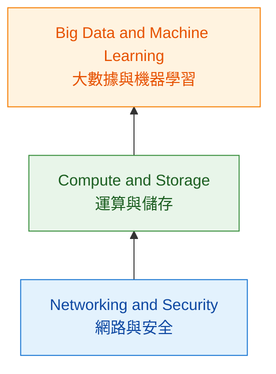
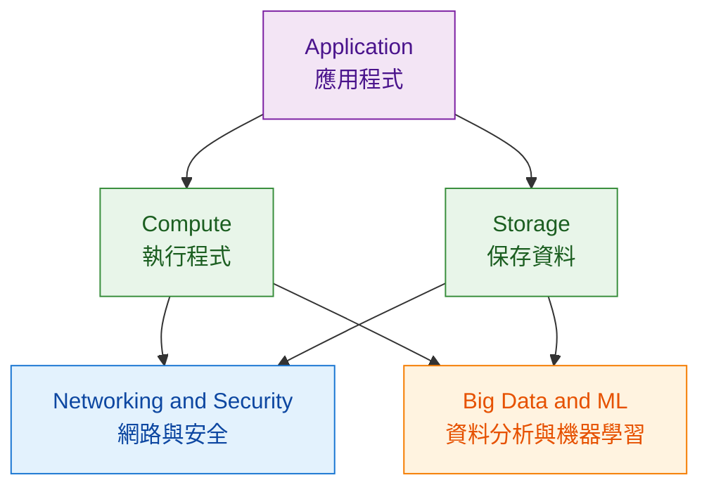

# Module 1｜Google Cloud 三層架構

> 預估閱讀時間：約 3 分鐘
> **Module 1 進度：** 🟡 進行中

## 本篇我要記住

Google Cloud Infrastructure｜Google Cloud 基礎架構，可以先理解成三層：

> **Networking and Security｜網路與安全 → Compute and Storage｜運算與儲存 → Big Data and Machine Learning｜大數據與機器學習**

---

## Google Cloud 三層架構

---

## Layer 1｜Networking and Security｜網路與安全

Google Cloud 的底層基礎。

Compute｜運算、Storage｜儲存與 Application｜應用程式，都需要建立在網路與安全機制上。

---

## Layer 2｜Compute and Storage｜運算與儲存

提供 Application 執行與保存資料所需要的核心資源。

### Compute｜運算

| Service                  | 中文                  |
| ------------------------ | ------------------- |
| Compute Engine           | 虛擬機器運算服務            |
| Google Kubernetes Engine | Kubernetes 容器管理服務   |
| App Engine               | 應用程式平台服務            |
| Cloud Run                | Serverless｜無伺服器容器服務 |
| Cloud Run Functions      | Serverless｜無伺服器函式服務 |

### Storage｜儲存

| Service       | 中文 / 類型                    |
| ------------- | -------------------------- |
| Cloud Storage | Object Storage｜物件儲存        |
| Cloud SQL     | Relational Database｜關聯式資料庫 |
| Spanner       | 分散式關聯式資料庫                  |
| Bigtable      | NoSQL Database｜NoSQL 資料庫   |
| Firestore     | NoSQL 文件資料庫                |

:::info 核心設計

Google Cloud 可以將 **Compute｜運算** 與 **Storage｜儲存** 分開管理。

兩者可以依需求獨立擴展，不需要綁在一起。
:::
---

## Layer 3｜Big Data and Machine Learning｜大數據與機器學習

處理資料的完整流程：

> **Ingest｜攝取 → Store｜儲存 → Process｜處理 → Analyze｜分析 → Machine Learning｜機器學習**

常見服務：

* BigQuery｜資料倉儲與分析
* Dataflow｜資料處理 Pipeline
* Pub/Sub｜訊息服務
* Looker｜商業智慧與資料分析
* Vertex AI｜機器學習與 AI 平台

這階段不用記住所有產品名稱，先理解：

> **Google Cloud 不只提供 Server 與 Database，也提供 Data 與 Machine Learning 的 Managed Services｜代管服務。**

---

## 系統觀

快速理解：

**Application 要有地方執行 → Compute**

**Application 要有地方保存資料 → Storage**

**服務之間要能連線並控制權限 → Networking and Security**

**資料累積後進一步處理與分析 → Big Data / ML**

---

## 最後記住

> **Google Cloud 三層架構：網路與安全打底 → 運算與儲存提供核心資源 → 大數據與機器學習進一步利用資料。**

