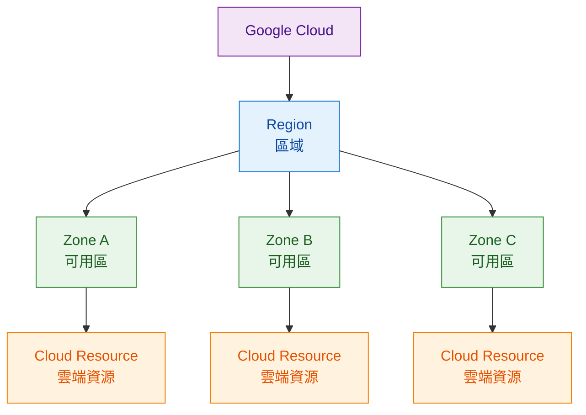
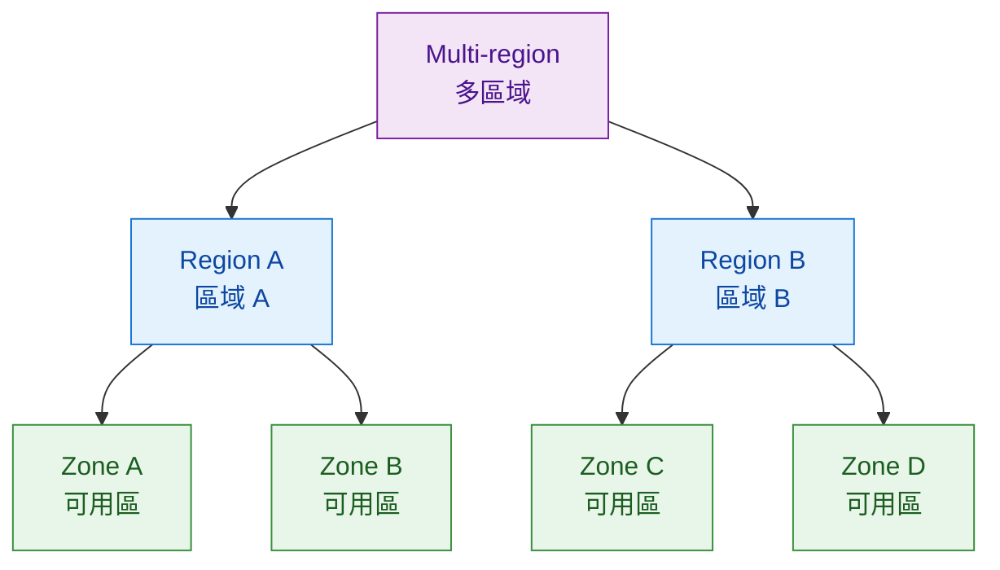

# Module 1｜Region、Zone 與 Multi-region

> 預估閱讀時間：約 3 分鐘

## 本篇我要記住

Google Cloud Resources｜Google Cloud 資源實際部署在不同 Location｜位置。

主要分成：

> **Zone｜可用區 < Region｜區域 < Multi-region｜多區域**

---

## Region｜區域

Region｜區域是一個獨立的 Geographic Area｜地理區域。

例如：

**London → europe-west2**

一個 Region 通常包含多個 Zone。

---

## Zone｜可用區

Zone｜可用區是 Google Cloud 資源實際部署的位置。

例如建立：

**Compute Engine Virtual Machine｜Compute Engine 虛擬機器**

需要指定 VM 所在的 Zone。

如果資源只部署在單一 Zone，該 Zone 發生問題時，服務可能受到影響。

因此架構設計會考慮：

**Redundancy｜備援**

---

## Multi-region｜多區域

Multi-region｜多區域代表跨越多個 Region。

某些 Google Cloud 服務可以將資料分散或複寫到不同 Region。

例如 Spanner｜分散式關聯式資料庫，可以將資料 Replicate｜複寫到多個位置。

---

## 為什麼 Location 很重要？

| 英文           | 中文  | 影響                  |
| ------------ | --- | ------------------- |
| Latency      | 延遲  | 使用者多久收到 Response｜回應 |
| Availability | 可用性 | 服務是否持續可使用           |
| Durability   | 持久性 | 資料是否可靠保存            |
| Redundancy   | 備援  | 發生故障時是否有替代資源        |

例如：

**台灣使用者 → 亞洲 Region**

通常會比：

**台灣使用者 → 歐洲 Region**

具有較低的 Latency｜延遲。

因此選擇 Region 本身就是架構設計的一部分。

---

## 快速記法

**Zone｜可用區**

→ 資源實際部署的位置

**Region｜區域**

→ 包含多個 Zone 的地理區域

**Multi-region｜多區域**

→ 跨越多個 Region

> **Zone < Region < Multi-region**

---

## 最後記住

> **Google Cloud 的部署位置會影響 Latency｜延遲、Availability｜可用性、Durability｜持久性與 Redundancy｜備援。**

---

## Module 1 TODO

| 狀態 | 學習目標                                           |
| -- | ---------------------------------------------- |
| ✅  | Cloud Computing｜雲端運算                           |
| ✅  | IT Infrastructure｜IT 基礎設施                      |
| ✅  | Physical、Virtual、Cloud Architecture｜實體、虛擬與雲端架構 |
| ✅  | IaaS、PaaS、SaaS｜雲端服務模式                          |
| ✅  | Google Cloud Compute｜Google Cloud 運算服務概覽       |
| ✅  | Google Cloud Storage｜Google Cloud 儲存服務概覽       |
| ✅  | Big Data 與 Machine Learning｜大數據與機器學習服務概覽       |
| ✅  | Google Network｜Google 全球網路概念                   |
| ✅  | Region、Zone、Multi-region｜區域、可用區與多區域            |
| ⬜  | Module 1 Quiz｜單元測驗                             |
