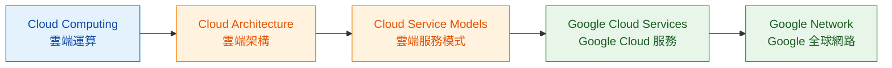

# Module 1｜總結：So What's the Cloud Anyway?

> 預估閱讀時間：約 2 分鐘

## 本篇我要記住

Module 1 建立的是整個 Google Cloud 的第一張地圖：

> **Cloud 是什麼 → 架構怎麼演進 → 雲端服務模式 → Google Cloud 提供什麼 → 資源實際部署在哪裡**

---

## 1. Cloud Computing｜雲端運算

Cloud Computing 有五個重要特徵：

| 英文名詞                   | 中文名詞   | 我的記法    |
| ---------------------- | ------ | ------- |
| On-demand Self-service | 隨需自助服務 | 需要就開    |
| Broad Network Access   | 廣泛網路存取 | 透過網路使用  |
| Resource Pooling       | 資源池化   | 集中資源再分配 |
| Rapid Elasticity       | 快速彈性伸縮 | 需求變化就擴縮 |
| Measured Service       | 可計量服務  | 依使用情況計費 |

**關鍵：Cloud 的核心是讓 IT Resources｜IT 資源可以隨需求取得與調整。**

---

## 2. Cloud Architecture｜雲端架構演進

Cloud Computing 經歷三波重要演進：

**Colocation｜主機代管**

↓

**Virtualized Data Center｜虛擬化資料中心**

↓

**Container-based Architecture｜容器化架構**

我的快速記法：

> **租機房 → 虛擬化資源 → 自動化與彈性 Cloud**

---

## 3. Cloud Service Models｜雲端服務模式

### IaaS｜Infrastructure as a Service｜基礎設施即服務

提供：

**Compute + Storage + Network**

我仍然需要管理較多 Infrastructure。

### PaaS｜Platform as a Service｜平台即服務

Infrastructure 管理再減少，我可以更專注：

**Application Logic｜應用程式邏輯**

### SaaS｜Software as a Service｜軟體即服務

Application 已經完成，我直接透過 Internet 使用。

例如：

**Gmail / Google Docs / Google Drive**

**關鍵：IaaS → PaaS → SaaS，我需要管理的技術層級越來越少。**

---

## 4. Google Cloud Services｜Google Cloud 服務

先建立服務分類，不需要現在全部背起來：

| 類型                    | 代表服務                                      |
| --------------------- | ----------------------------------------- |
| Compute｜運算            | Compute Engine、GKE、Cloud Run              |
| Storage｜儲存            | Cloud Storage、Cloud SQL、Spanner、Firestore |
| Big Data｜大數據          | BigQuery、Dataflow、Pub/Sub                 |
| Machine Learning｜機器學習 | Vertex AI                                 |

**關鍵：先知道服務屬於哪一類，後面的 Module 再深入。**

---

## 5. Google Network｜Google 全球網路

Google Cloud 的虛擬資源，底層仍然建立在全球實體 Infrastructure 上。

資源部署位置可以先記：

**Multi-region｜多區域**

↓

**Region｜區域**

↓

**Zone｜可用區**

Location｜位置會影響：

* Latency｜延遲
* Availability｜可用性
* Durability｜持久性
* Redundancy｜備援

---

## Cheat Sheet

| 看到這個                  | 我要想到                        |
| --------------------- | --------------------------- |
| Cloud Computing       | 五大特徵                        |
| Colocation            | 租用實體機房空間                    |
| Virtualization        | 實體資源虛擬化                     |
| Container-based Cloud | 自動化、彈性                      |
| IaaS                  | Compute + Storage + Network |
| PaaS                  | 專注 Application Logic        |
| SaaS                  | 直接使用 Application            |
| Region                | 包含多個 Zone                   |
| Zone                  | Cloud Resource 實際部署位置       |

---

## Module 1 TODO

| 狀態 | 學習內容                                           |
| -- | ---------------------------------------------- |
| ✅  | Cloud Computing｜雲端運算                           |
| ✅  | Physical、Virtual、Cloud Architecture｜實體、虛擬與雲端架構 |
| ✅  | IaaS、PaaS、SaaS｜雲端服務模式                          |
| ✅  | Compute、Storage｜運算與儲存服務                        |
| ✅  | Big Data、Machine Learning｜大數據與機器學習             |
| ✅  | Google Network｜Google 全球網路                     |
| ✅  | Region、Zone、Multi-region｜區域、可用區與多區域            |
| ⬜  | Module 1 Quiz｜單元測驗                             |

---

## 最後記住

> **Module 1 的核心不是背 Google Cloud 產品，而是先理解 Cloud 如何提供 IT 資源、Cloud Architecture 如何演進，以及 Google Cloud 整體 Infrastructure 的基本地圖。**
