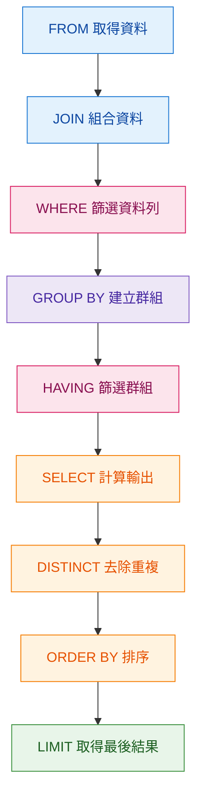
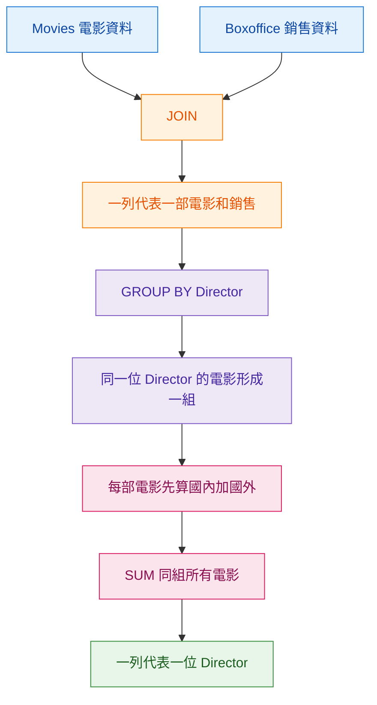

本文參考：[SQL Lesson 12: Order of execution of a Query](https://sqlbolt.com/lesson/select_queries_order_of_execution)

# SQL Query Order of Execution：我寫 SELECT 在最前面，但它其實不是先執行

---

> 預估閱讀時間：約 8 分鐘

## 本篇觀念要點

我平常寫 SQL 時，順序看起來是：

```sql
SELECT
FROM
JOIN
WHERE
GROUP BY
HAVING
ORDER BY
LIMIT
```

所以我很容易直覺認為：

> SQL 就是從 `SELECT` 開始一路往下執行。

但我要分清楚兩件事情：

```text
SQL 的書寫順序
≠
SQL 的邏輯執行順序
```

SQL 的邏輯執行順序，可以先記成：

```text
FROM 和 JOIN
→ WHERE
→ GROUP BY
→ HAVING
→ SELECT
→ DISTINCT
→ ORDER BY
→ LIMIT 和 OFFSET
```

理解這個順序之後，我以前很多「為什麼 SQL 不能這樣寫」的問題就會比較合理。

例如：

* 為什麼 `WHERE` 和 `HAVING` 不一樣
* 為什麼 `WHERE` 常常不能直接使用 `SELECT` 的 Alias
* 為什麼 `ORDER BY` 卻可以使用 Alias
* 為什麼是 JOIN 完資料後才 GROUP BY
* Aggregate Function 到底是在什麼資料上計算

:::info 學習主線

先取得資料
→ JOIN 成我要工作的資料
→ WHERE 篩 Row
→ GROUP BY 把 Row 分成 Group
→ HAVING 篩 Group
→ SELECT 計算與輸出結果
→ DISTINCT 去重複
→ ORDER BY 排序
→ LIMIT 取最後需要的資料
:::
---

# 為什麼我要理解 Query Execution Order

假設我看到：

```sql
SELECT
    m.Director,
    SUM(b.domestic_sales + b.international_sales) AS total_sales
FROM Movies AS m
INNER JOIN Boxoffice AS b
    ON b.Movie_id = m.Id
GROUP BY m.Director;
```

如果照程式碼從上往下看，我可能會以為：

```text
先 SELECT
↓
再找 Movies
↓
再 JOIN Boxoffice
↓
最後 GROUP BY
```

但這不是我理解 SQL 資料流的方式。

我應該想：

```text
先取得 Movies
↓
JOIN Boxoffice
↓
現在每一列有電影、導演和票房
↓
按照 Director 分組
↓
每個 Director 得到自己的電影 Group
↓
SUM 每一組的電影票房
↓
SELECT 最後輸出 Director 和總銷售
```

所以我要記：

> **SELECT 雖然寫在第一行，但在邏輯執行上其實很後面。**

---

# SQL Query 的邏輯執行順序



---

# 1. FROM 和 JOIN：先建立我要工作的資料

第一個階段不是 `SELECT`。

而是：

```sql
FROM ...
JOIN ...
```

我可以把它理解成：

> **先決定這次 Query 到底有哪些資料可以使用。**

例如：

```sql
FROM Movies AS m
INNER JOIN Boxoffice AS b
    ON b.Movie_id = m.id
```

代表：

```text
Movies
+
Boxoffice
↓
透過電影 Id 接起來
↓
得到新的 Working Set
```

這時候最重要的是問自己：

> **JOIN 完以後，一列現在代表什麼？**

如果 JOIN 完是一部電影配上一筆 Boxoffice：

```text
一列
=
一部電影
+
它的導演
+
它的票房資料
```

這會直接影響我後面怎麼 GROUP BY。

---

# 2. WHERE：先篩選原始 Row

有了 Working Set 之後才輪到：

```sql
WHERE
```

例如：

```sql
WHERE m.Year >= 2000
```

意思是：

```text
JOIN 完的所有電影 Rows
↓
一列一列判斷 Year
↓
符合條件 → 留下
不符合條件 → 丟掉
```

所以我要把 `WHERE` 記成：

> **在分組以前，先篩選單筆 Row。**

---

# WHERE 和 HAVING 為什麼不一樣

我以前很容易只記：

```text
WHERE 不能處理 Aggregate
HAVING 可以
```

但其實更重要的是它們所在的位置。

```text
FROM 和 JOIN
↓
得到 Rows
↓
WHERE
↓
篩 Rows
↓
GROUP BY
↓
Rows 形成 Groups
↓
HAVING
↓
篩 Groups
```

所以：

### WHERE

我現在處理的是：

> Row。

### HAVING

我現在處理的是：

> Group。

這樣我就不用死背它們的差異。

---

# 3. GROUP BY：把 Row 變成 Group

例如：

```sql
GROUP BY m.Director
```

這一步本身不是在計算總銷售。

它只是說：

> **相同 Director 的電影 Rows 要被放在同一組。**

例如原本：

```text
John Lasseter → Toy Story
John Lasseter → A Bug's Life
John Lasseter → Toy Story 2
Andrew Stanton → Finding Nemo
Andrew Stanton → WALL-E
```

經過：

```sql
GROUP BY m.Director
```

我可以想成：

```text
John Lasseter Group
├── Toy Story
├── A Bug's Life
└── Toy Story 2

Andrew Stanton Group
├── Finding Nemo
└── WALL-E
```

所以我前面學過的 Mental Model 還是一樣：

> **GROUP BY 回答的是：誰一組？**

---

# 4. HAVING：Group 建好之後才篩選

例如：

```sql
GROUP BY m.Director
HAVING COUNT(*) >= 2
```

Group 已經先形成：

```text
John Lasseter
→ 5 部電影

Andrew Stanton
→ 2 部電影

Brenda Chapman
→ 1 部電影
```

然後：

```sql
HAVING COUNT(*) >= 2
```

才做：

```text
John Lasseter → 留下
Andrew Stanton → 留下
Brenda Chapman → 排除
```

所以：

> **HAVING 是在 Aggregate / Group 層級做篩選。**

---

# 5. SELECT：現在才決定我要輸出什麼

到了這裡才真正處理：

```sql
SELECT
```

例如：

```sql
SELECT
    m.Director,
    SUM(b.domestic_sales + b.international_sales)
```

這時前面已經知道：

```text
有哪些資料
↓
哪些 Row 留下
↓
哪些 Row 屬於同一個 Director Group
```

所以現在才能真正計算最後要輸出的結果。

---

# 6. DISTINCT：對 SELECT 結果去重複

例如：

```sql
SELECT DISTINCT Director
FROM Movies;
```

可以理解成：

```text
FROM Movies
↓
SELECT Director
↓
得到 Director 結果
↓
DISTINCT
↓
移除重複值
```

---

# 7. ORDER BY：最後才排序

例如：

```sql
SELECT
    m.Director,
    SUM(b.domestic_sales + b.international_sales) AS total_sales
FROM Movies AS m
JOIN Boxoffice AS b
    ON b.Movie_id = m.id
GROUP BY m.Director
ORDER BY total_sales DESC;
```

到 `ORDER BY` 的時候：

```text
SELECT
↓
total_sales 已經計算完成
↓
ORDER BY
```

所以這時通常可以使用：

```sql
total_sales
```

這個 Alias。

---

# 為什麼 WHERE 常常不能使用 SELECT Alias

例如：

```sql
SELECT
    domestic_sales + international_sales AS total_sales
FROM Boxoffice
WHERE total_sales > 500000000;
```

我可能會想：

> 我上面明明已經把它取名叫 `total_sales` 了。

但我要改成看執行順序：

```text
FROM
↓
WHERE
↓
SELECT
```

執行 `WHERE` 的時候：

```text
total_sales
```

這個 `SELECT` Alias 還沒有產生。

所以我要記：

> **SQL 寫在上面，不代表比較早執行。**

---

# 8. LIMIT 和 OFFSET：最後再決定拿幾筆

例如：

```sql
ORDER BY total_sales DESC
LIMIT 3;
```

不是：

```text
先抓 3 筆
↓
再排序
```

而是：

```text
先完成結果
↓
ORDER BY 排序
↓
LIMIT
↓
拿排序後前三筆
```

---

# SQL 的書寫順序和執行順序

## 我寫 SQL 時

```text
SELECT
FROM
JOIN
WHERE
GROUP BY
HAVING
ORDER BY
LIMIT
```

## 我理解資料怎麼流時

```text
FROM
JOIN
WHERE
GROUP BY
HAVING
SELECT
DISTINCT
ORDER BY
LIMIT
```

這兩個順序我要分開。

---

# SQLBolt Exercise 12

前面是觀念。

接下來我要用 SQLBolt 的練習題，把這個執行順序真正套到資料上。

## 原始資料表 Movies

| id | title               | director       | year | length_minutes |
| -: | ------------------- | -------------- | ---: | -------------: |
|  1 | Toy Story           | John Lasseter  | 1995 |             81 |
|  2 | A Bug's Life        | John Lasseter  | 1998 |             95 |
|  3 | Toy Story 2         | John Lasseter  | 1999 |             93 |
|  4 | Monsters, Inc.      | Pete Docter    | 2001 |             92 |
|  5 | Finding Nemo        | Andrew Stanton | 2003 |            107 |
|  6 | The Incredibles     | Brad Bird      | 2004 |            116 |
|  7 | Cars                | John Lasseter  | 2006 |            117 |
|  8 | Ratatouille         | Brad Bird      | 2007 |            115 |
|  9 | WALL-E              | Andrew Stanton | 2008 |            104 |
| 10 | Up                  | Pete Docter    | 2009 |            101 |
| 11 | Toy Story 3         | Lee Unkrich    | 2010 |            103 |
| 12 | Cars 2              | John Lasseter  | 2011 |            120 |
| 13 | Brave               | Brenda Chapman | 2012 |            102 |
| 14 | Monsters University | Dan Scanlon    | 2013 |            110 |

---

## 原始資料表 Boxoffice

| movie_id | rating | domestic_sales | international_sales |
| -------: | -----: | -------------: | ------------------: |
|        5 |    8.2 |      380843261 |           555900000 |
|       14 |    7.4 |      268492764 |           475066843 |
|        8 |    8.0 |      206445654 |           417277164 |
|       12 |    6.4 |      191452396 |           368400000 |
|        3 |    7.9 |      245852179 |           239163000 |
|        6 |    8.0 |      261441092 |           370001000 |
|        9 |    8.5 |      223808164 |           297503696 |
|       11 |    8.4 |      415004880 |           648167031 |
|        1 |    8.3 |      191796233 |           170162503 |
|        7 |    7.2 |      244082982 |           217900167 |
|       10 |    8.3 |      293004164 |           438338580 |
|        4 |    8.1 |      289916256 |           272900000 |
|        2 |    7.2 |      162798565 |           200600000 |
|       13 |    7.2 |      237283207 |           301700000 |

---

# Exercise 1：每位導演執導過幾部電影？

題目：

> Find the number of movies each director has directed.

我先不要急著寫 SQL。

先看題目最後希望：

```text
John Lasseter → 一列
Andrew Stanton → 一列
Brad Bird → 一列
...
```

所以：

> **最後一列代表一位 Director。**

### 誰一組？

```text
Director
```

所以：

```sql
GROUP BY Director
```

### 每組算什麼？

每位 Director 有幾個 Movie Rows。

所以：

```sql
COUNT(*)
```

查詢概念：

```sql
SELECT
    Director,
    COUNT(*) AS movie_count
FROM Movies
GROUP BY Director;
```

這一題不需要 JOIN。

因為：

```text
Director
+
Movie
```

本來就都在 `Movies` 裡。

---

# Exercise 2：每位導演所有電影的國內加國外總銷售

題目：

> Find the total domestic and international sales that can be attributed to each director.

這一題跟上一題最大的差別是：

> `Movies` 裡只有 Director，沒有 Sales。

銷售資料在：

```text
Boxoffice
```

所以我要先 JOIN。

---

## 我的 SQL

```sql
SELECT
    m.Director,
    SUM(b.domestic_sales + b.international_sales) AS 所有電影總銷售
FROM Movies AS m
INNER JOIN Boxoffice AS b
    ON b.Movie_id = m.id
GROUP BY m.Director;
```

現在不要只看答案。

我要按照 Query Execution Order 看資料到底怎麼變。

---

# Step 1：FROM Movies

```sql
FROM Movies AS m
```

現在我的資料只有：

```text
電影
導演
年份
片長
```

例如：

| id | title        | director       |
| -: | ------------ | -------------- |
|  1 | Toy Story    | John Lasseter  |
|  2 | A Bug's Life | John Lasseter  |
|  3 | Toy Story 2  | John Lasseter  |
|  5 | Finding Nemo | Andrew Stanton |

這時：

> **一列 = 一部電影。**

但是我現在還不知道電影賺多少錢。

---

# Step 2：JOIN Boxoffice

```sql
INNER JOIN Boxoffice AS b
    ON b.Movie_id = m.id
```

我要把：

```text
Movies.id
```

和：

```text
Boxoffice.movie_id
```

配起來。

例如：

```text
Movies

id 1
Toy Story
John Lasseter
```

找到：

```text
Boxoffice

movie_id 1
Domestic 191796233
International 170162503
```

JOIN 後：

| movie_id | title        | director       | domestic_sales | international_sales |
| -------: | ------------ | -------------- | -------------: | ------------------: |
|        1 | Toy Story    | John Lasseter  |      191796233 |           170162503 |
|        2 | A Bug's Life | John Lasseter  |      162798565 |           200600000 |
|        3 | Toy Story 2  | John Lasseter  |      245852179 |           239163000 |
|        5 | Finding Nemo | Andrew Stanton |      380843261 |           555900000 |
|        9 | WALL-E       | Andrew Stanton |      223808164 |           297503696 |

現在我要重新問一次：

> **JOIN 後的一列代表什麼？**

答案是：

> **一部電影 + 這部電影的 Director + 這部電影的 Sales。**

---

# Step 3：GROUP BY Director

題目不是要：

> 每部電影總共賣多少。

而是：

> **每位 Director 的所有電影總共賣多少。**

所以最後我要：

```text
John Lasseter → 一列
Andrew Stanton → 一列
Brad Bird → 一列
```

因此：

```sql
GROUP BY m.Director
```

把相同 Director 的 Movie Rows 收在一起。

例如：

```text
John Lasseter Group
├── Toy Story
├── A Bug's Life
├── Toy Story 2
├── Cars
└── Cars 2
```

Andrew Stanton：

```text
Andrew Stanton Group
├── Finding Nemo
└── WALL-E
```

所以這一步回答的是：

> **誰一組？**

答案：

> Director。

---

# Step 4：一部電影自己的總銷售

現在看：

```sql
b.domestic_sales + b.international_sales
```

這裡我要先不要看外面的 `SUM()`。

先只看：

```text
Domestic Sales
+
International Sales
```

這是在算：

> **一部電影自己的總銷售。**

例如 Toy Story：

```text
191796233
+
170162503
↓
361958736
```

A Bug's Life：

```text
162798565
+
200600000
↓
363398565
```

所以概念是：

```text
Movie Row 1
→ 國內 + 國外
→ Movie Total 1

Movie Row 2
→ 國內 + 國外
→ Movie Total 2
```

這個加法本身是在 Row Level 做計算。

---

# Step 5：SUM 同一位導演的所有電影

現在才把外面的：

```sql
SUM(...)
```

放回來。

完整是：

```sql
SUM(
    b.domestic_sales + b.international_sales
)
```

我要拆成兩層看：

```text
第一層
每一部 Movie Row

Domestic
+
International
↓
這部電影總銷售
```

接著：

```text
第二層
同一個 Director Group

Movie Total 1
+
Movie Total 2
+
Movie Total 3
...
↓
SUM
↓
這位 Director 所有電影總銷售
```

例如 John Lasseter：

```text
Toy Story 總銷售
+
A Bug's Life 總銷售
+
Toy Story 2 總銷售
+
Cars 總銷售
+
Cars 2 總銷售
↓
SUM
↓
2232208025
```

所以：

```sql
SUM(b.domestic_sales + b.international_sales)
```

我可以直接讀成：

> **先算每部電影自己的國內加國外銷售，再把同一位導演所有電影的結果全部加起來。**

---

# Step 6：SELECT 最後輸出

最後才看：

```sql
SELECT
    m.Director,
    SUM(...) AS 所有電影總銷售
```

前面已經完成：

```text
Movies + Boxoffice
↓
一列是一部電影與它的銷售資料
↓
按照 Director 分組
↓
每位 Director 有自己的 Movie Group
↓
SUM 每組所有電影
```

所以最後輸出：

| Director       |    所有電影總銷售 |
| -------------- | ---------: |
| Andrew Stanton | 1458055121 |
| Brad Bird      | 1255164910 |
| Brenda Chapman |  538983207 |
| Dan Scanlon    |  743559607 |
| John Lasseter  | 2232208025 |
| Lee Unkrich    | 1063171911 |
| Pete Docter    | 1294159000 |

現在：

> **一列 = 一位 Director。**

---

# Exercise 2 的完整資料流



---

# 我怎麼拆這題

以後遇到類似 Aggregate 題，我可以先填：

```text
原始 Movies 一列代表：
→ 一部電影

缺什麼資料：
→ Sales

Sales 在哪：
→ Boxoffice

JOIN 後一列代表：
→ 一部電影 + Director + Sales

最後 Output 一列代表：
→ 一位 Director

誰一組：
→ Director

每一列先算什麼：
→ Domestic + International

每一組再算什麼：
→ SUM 所有電影的結果
```

然後才翻譯成：

```sql
SELECT
    m.Director,
    SUM(b.domestic_sales + b.international_sales) AS 所有電影總銷售
FROM Movies AS m
INNER JOIN Boxoffice AS b
    ON b.Movie_id = m.id
GROUP BY m.Director;
```

---

# 這題和前面 Function Mental Model 的關係

這題其實剛好把前面的觀念全部串起來。

### Row Level 計算

```sql
b.domestic_sales + b.international_sales
```

代表：

```text
一部電影
↓
計算自己的國內 + 國外
↓
這部電影自己的總銷售
```

### Aggregate 計算

```sql
SUM(...)
```

代表：

```text
同一位 Director 的多部電影
↓
SUM
↓
一個 Director 的總銷售
```

### GROUP BY

```sql
GROUP BY m.Director
```

代表：

> 誰一組？

答案：

> Director。

所以：

```text
GROUP BY
→ 誰一組

Row Expression
→ 每一列先算什麼

Aggregate Function
→ 每一組再算什麼
```

---

# Cheat Sheet

| 執行階段                       | 這題發生什麼           |
| -------------------------- | ---------------- |
| `FROM Movies`              | 先拿電影資料           |
| `JOIN Boxoffice`           | 補上每部電影的 Sales    |
| JOIN 後粒度                   | 一列是一部電影和它的銷售     |
| `GROUP BY Director`        | 同一導演的電影放成一組      |
| `Domestic + International` | 算一部電影自己的總銷售      |
| `SUM`                      | 把同一導演所有電影加起來     |
| `SELECT`                   | 輸出 Director 和總銷售 |
| 最後粒度                       | 一列是一位 Director   |

---

# 一句話記住

SQL 的 Query Execution Order 不只是要我背：

```text
FROM
JOIN
WHERE
GROUP BY
HAVING
SELECT
```

真正重要的是，我可以沿著執行順序一直追蹤：

> **現在的一列代表什麼？**

這題就是：

```text
Movies
→ 一列是一部電影

JOIN Boxoffice
→ 一列是一部電影和它的 Sales

GROUP BY Director
→ 同一位 Director 的電影成為一組

Domestic + International
→ 每部電影先算自己的總銷售

SUM
→ 每組再加總所有電影

SELECT
→ 最後一列是一位 Director
```

> **從「一部電影」一步一步變成「一位導演的總銷售」。**
