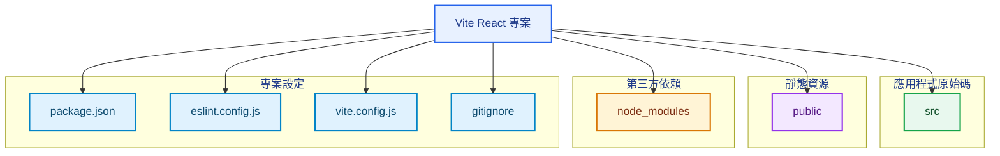
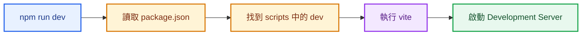
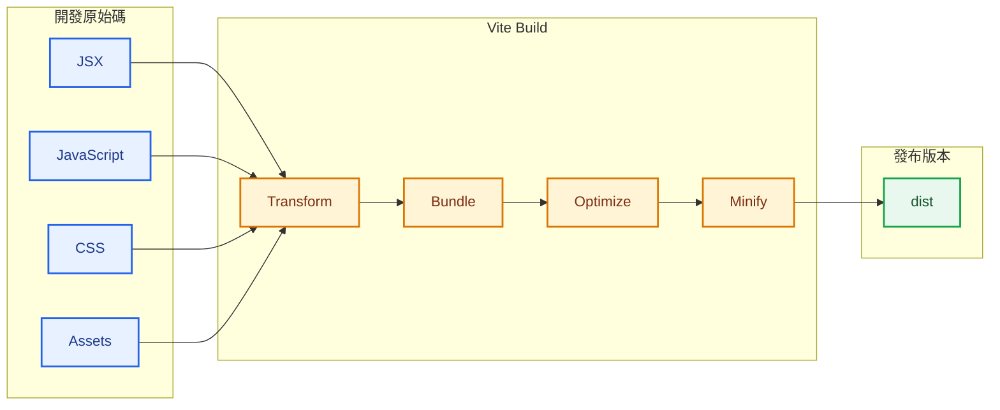
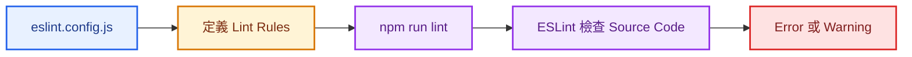
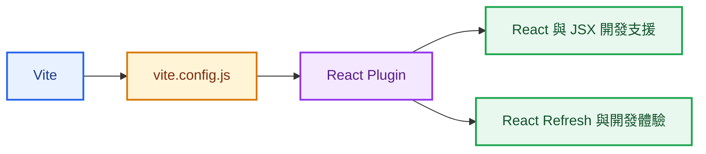
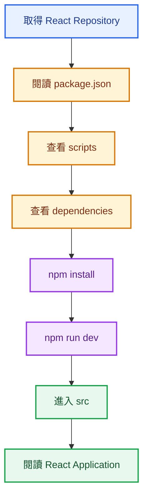
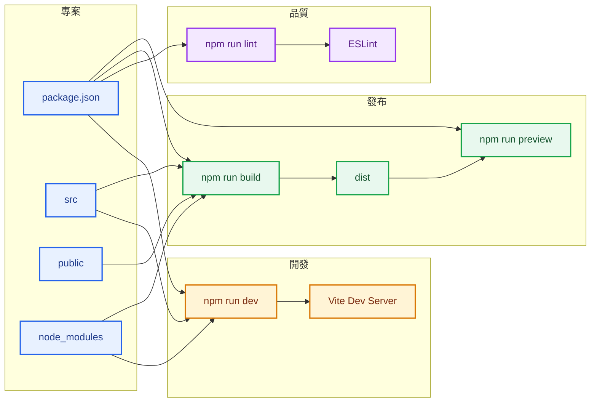

> 預估閱讀時間：約 8 分鐘

## 本篇觀念要點

<Highlight>

學習 Vite 專案結構，不是背每一個檔案名稱。

真正要建立的是：

**拿到一個 React 專案後，能快速判斷程式碼在哪裡、依賴放在哪裡、專案怎麼啟動、怎麼檢查，以及最後如何產生可以部署的版本。**

</Highlight>

1. [Vite 建立了什麼](#vite-project)
2. [React 專案的四個區域](#project-areas)
3. [node_modules 與 public](#modules-public)
4. [src 原始碼目錄](#src)
5. [gitignore 的角色](#gitignore)
6. [package.json 是什麼](#package-json)
7. [dependencies 與 devDependencies](#dependencies)
8. [scripts 是什麼](#scripts)
9. [dev 開發模式](#dev)
10. [build 正式建置](#build)
11. [lint 程式碼檢查](#lint)
12. [preview 預覽正式版本](#preview)
13. [vite.config.js 與 React Plugin](#vite-config)
14. [完整開發流程](#workflow)
15. [快速閱讀陌生 React 專案](#read-project)
16. [系列總結](#summary)

---

## Vite 建立了什麼 {#vite-project}

使用 Vite 建立 React 專案後，會先得到一套可以直接開始開發的專案骨架。

典型結構：

```text
my-react-app/
│
├── node_modules/
├── public/
│
├── src/
│
├── .gitignore
├── eslint.config.js
├── index.html
├── package.json
├── package-lock.json
├── README.md
└── vite.config.js
```


這些檔案可以先分成四個區域：



目前不需要記住所有細節。

先建立一個最基本的專案地圖：

```text
src
→ 我主要寫程式的地方

public
→ 靜態資源

node_modules
→ 安裝進來的第三方套件

package.json
→ 專案資訊、依賴與操作指令

設定檔
→ 定義工具如何工作
```

---

## React 專案的四個區域 {#project-areas}

從工程角度來看，可以把 Vite 專案理解成：

| 區域             | 主要用途                    |
| -------------- | ----------------------- |
| `src`          | Application Source Code |
| `public`       | Static Assets           |
| `node_modules` | Installed Packages      |
| Config Files   | 專案與工具設定                 |

這比單純背資料夾名稱更重要。

看到陌生 React Repository 時，可以先問：

```text
程式碼在哪裡？
→ src

用了哪些套件？
→ package.json

套件實際安裝在哪？
→ node_modules

怎麼啟動？
→ package.json scripts

Vite 怎麼設定？
→ vite.config.js
```

---

## node_modules 與 public {#modules-public}

### node_modules

`node_modules` 是套件安裝目錄。

例如：

```text
node_modules/
├── react/
├── react-dom/
├── vite/
├── eslint/
└── ...
```

這些並不是目前專案自己撰寫的主要程式碼，而是透過 npm 安裝進來的第三方 Packages。

### Do what

保存目前專案實際安裝的 Dependencies。

### How

執行：

```bash
npm install
```

npm 會依照專案的套件資訊安裝需要的 Packages。

### Why

React、Vite、ESLint 等工具都不需要重新實作。

現代 JavaScript Application 會透過 Package Manager 組合現成的 Libraries 與 Tools。

:::tip node_modules 通常不進 Git

`node_modules` 通常不會 Commit 到 Git Repository。

其他開發者取得專案後，可以重新執行：

```bash
npm install
```

建立自己的 `node_modules`。

---

### public

`public` 用來保存希望直接提供的 Static Assets。

例如：

```text
public/
└── vite.svg
```


可以先理解為：

```text
public
→ 希望原樣提供的靜態檔案
```

常見內容包括：

```text
favicon
robots.txt
固定路徑圖片
其他不需要透過 JavaScript import 的靜態檔案
```

不過圖片不一定全部放在 `public`。

Vite 專案也常見：

```text
src/
└── assets/
```

兩者可以先這樣區分：

```text
public
→ 直接提供的 Static Asset

src/assets
→ 跟 Application Module 一起管理的 Asset
```

---

## src 原始碼目錄 {#src}

`src` 是 Source 的縮寫。

這裡是 React Application 最主要的開發區域。

Vite React Template 可能包含：

```text
src/
├── assets/
├── App.css
├── App.jsx
├── index.css
└── main.jsx
```


目前先建立一個概念：

> **Vite 負責建立與執行開發環境，而真正的 React Application Code 主要從 src 開始閱讀。**

之後進入 React 本身時，會再進一步追：

```text
index.html
→ main.jsx
→ App.jsx
→ Components
```

---

## gitignore 的角色 {#gitignore}

`.gitignore` 用來告訴 Git：

> 哪些檔案或目錄不需要被 Version Control 追蹤。

例如：

```gitignore
node_modules
dist
.env
```

常見原因：

| 項目             | 不提交的原因                    |
| -------------- | ------------------------- |
| `node_modules` | 體積大，而且可以重新安裝              |
| `dist`         | 可以重新 Build                |
| `.env`         | 可能包含 Secret、API Key 等敏感資訊 |

可以把它理解成：

```text
專案檔案
   ↓
gitignore 規則
   ↓
Git 判斷是否追蹤
   ↓
Commit
```

Git 管理的是：

> **需要被保存與追蹤的 Source Code 與專案設定。**

不是所有在電腦上的檔案都必須進 Repository。

---

## package.json 是什麼 {#package-json}

`package.json` 是 JavaScript 專案非常重要的描述檔。

它同時描述：

```text
這個專案是什麼
用了哪些 Packages
有哪些開發工具
有哪些 Commands 可以執行
```

例如：

```json
{
  "name": "monsters-rolodex",
  "private": true,
  "version": "0.0.0",
  "type": "module"
}
```

其中：

```text
name
→ Package 或 Project 名稱

version
→ 版本資訊

private
→ 避免專案被意外發布成公開 npm Package

type
→ JavaScript Module 模式
```

對閱讀 React 專案來說，目前最重要的是三個區域：

```text
package.json
│
├── scripts
├── dependencies
└── devDependencies
```


---

## dependencies 與 devDependencies {#dependencies}

### dependencies

例如：

```json
"dependencies": {
  "react": "^18.3.1",
  "react-dom": "^18.3.1"
}
```

可以理解為：

> Application 本身使用的核心 Packages。

例如 React Application 本身就需要：

```text
react
react-dom
```

---

### devDependencies

例如：

```json
"devDependencies": {
  "@vitejs/plugin-react": "...",
  "eslint": "...",
  "vite": "..."
}
```

這些主要是協助：

```text
開發
Build
Lint
Tooling
Developer Experience
```

的 Packages。

目前可以先用這個模型：

```text
dependencies
→ Application 使用的依賴

devDependencies
→ 開發與建置工具相關依賴
```

---

## scripts 是什麼 {#scripts}

`scripts` 是 `package.json` 裡非常重要的一個區域。

例如：

```json
"scripts": {
  "dev": "vite",
  "build": "vite build",
  "lint": "eslint .",
  "preview": "vite preview"
}
```

它本質上是一組：

```text
Command Name
→ Actual Command
```

例如：

```text
dev
→ vite

build
→ vite build

lint
→ eslint .

preview
→ vite preview
```

當執行：

```bash
npm run dev
```

流程不是 npm 自己知道如何啟動 React。

而是：



因此 npm script 可以理解成：

> **替專案常用操作建立統一入口。**

---

## dev 開發模式 {#dev}

設定：

```json
"dev": "vite"
```

執行：

```bash
npm run dev
```

### Do what

啟動 Vite Development Server。

### How

概念流程：

```text
src
↓
Vite Development Server
↓
localhost
↓
Browser
```

瀏覽器通常會取得一個 Local URL，例如：

```text
localhost:5173
```

### Why

開發 React 時會持續修改：

```text
JSX
CSS
Component
State
Application Logic
```

如果每次修改都重新正式 Build，開發速度會非常慢。

Development Server 提供快速的開發循環：

```text
修改 Code
→ 儲存
→ Vite 更新
→ Browser 看到結果
→ 繼續修改
```

其中一個重要能力是：

**HMR — Hot Module Replacement，熱模組替換。**

它讓開發過程中的 Module 變化可以快速反映到瀏覽器。

---

## build 正式建置 {#build}

設定：

```json
"build": "vite build"
```

執行：

```bash
npm run build
```

### Do what

將目前的 Application 建置成適合發布的版本。

### How

概念上：



Build 完成後會出現：

```text
dist/
```

例如：

```text
dist/
├── assets/
│   ├── index-xxxxx.js
│   ├── index-xxxxx.css
│   └── react-xxxxx.svg
├── index.html
└── vite.svg
```


`dist` 是 **Distribution** 的縮寫。

可以理解成：

```text
src
→ 開發時閱讀與修改

dist
→ Build 後準備發布
```

---

### 為什麼 dist 裡的 JavaScript 很難閱讀？

Production Build 會對程式進行最佳化與 Minification。

因此原本適合開發者閱讀的程式碼，Build 後可能變成：

```text
很短的變數名稱
較少的空白
大量程式碼集中
檔名帶有 Hash
```

在 Browser DevTools 的 Network 中，可以看到實際載入：

```text
index-xxxxx.js
index-xxxxx.css
```


這些名稱可以和 `dist/assets` 裡的 Build Files 對應。

因此可以確認：

> Browser 現在取得的是 Build 後的 Assets，而不是直接閱讀開發時的 `App.jsx`。

---

## lint 程式碼檢查 {#lint}

設定：

```json
"lint": "eslint ."
```

執行：

```bash
npm run lint
```

其中：

```text
.
→ Current Directory
→ 目前目錄
```

因此：

```bash
eslint .
```

可以先理解成：

> 從目前專案開始，依照 ESLint 設定檢查符合範圍的程式碼。

例如：

```js
const hello = 'Hello';
```

如果 `hello` 被宣告後完全沒有使用，Lint Rule 可能回報：

```text
hello is assigned a value but never used
```

整體流程：



:::warning Lint 不等於 Test

Lint 主要檢查：

* Code Convention
* 可疑寫法
* 未使用變數
* ESLint Rules
* 部分潛在問題

它不是在證明：

> Application 的商業邏輯一定正確。

因此：

```text
Lint
≠
Unit Test
≠
Integration Test
```

它們解決的是不同問題。

:::

---

## preview 預覽正式版本 {#preview}

設定：

```json
"preview": "vite preview"
```

執行：

```bash
npm run preview
```

`preview` 和 `dev` 都會啟動 Local Server，但兩者看的東西不同。

### dev

```text
Source Code
↓
Vite Development Server
↓
Browser
```

### preview

```text
Source Code
↓
npm run build
↓
dist
↓
Vite Preview Server
↓
Browser
```

因此一般流程是：

```bash
npm run build
npm run preview
```

`preview` 的目的不是取代 Production Server，而是：

> **在本機檢查 Build 後的 Application。**

---

### dev 與 preview 對照

|                      | `npm run dev`    | `npm run preview`   |
| -------------------- | ---------------- | ------------------- |
| 用途                   | 開發               | 檢查 Production Build |
| 主要來源                 | 開發中的 Application | `dist`              |
| 是否需要先 Build          | 不需要              | 需要                  |
| Local Server         | 是                | 是                   |
| 正式 Production Server | 否                | 否                   |

這個差異可以簡化成：

```text
dev
→ 我現在正在做什麼

preview
→ 我最後準備發布什麼
```

---

## vite.config.js 與 React Plugin {#vite-config}

Vite React Template 還會產生：

```text
vite.config.js
```

例如：

```js
import { defineConfig } from 'vite';
import react from '@vitejs/plugin-react';

export default defineConfig({
  plugins: [react()],
});
```


目前不需要深入所有 Vite Config Options。

先理解它的角色：

> **vite.config.js 用來設定 Vite 在這個專案中應該如何工作。**

---

### React Plugin

這裡：

```js
import react from '@vitejs/plugin-react';
```

載入 Vite 的 React Plugin。

接著：

```js
plugins: [react()]
```

把 React Plugin 加入 Vite Config。

概念上：



Vite 本身不是只為 React 存在。

React Template 透過 Plugin 告訴 Vite：

```text
這是一個 React Application
→ 載入 React 相關整合
```

目前看到：

```text
vite.config.js
```

先翻譯成：

> **Vite 的專案設定檔。**

不需要現在深入 Config API。

---

## 完整開發流程 {#workflow}

把目前所有概念串起來：

```mermaid
flowchart LR

    subgraph DevelopmentLayer["開發階段"]
        A["src"]
        B["npm run dev"]
        C["Browser 開發"]
    end

    subgraph QualityLayer["檢查階段"]
        D["npm run lint"]
        E["ESLint Rules"]
    end

    subgraph BuildLayer["建置階段"]
        F["npm run build"]
        G["dist"]
    end

    subgraph PreviewLayer["發布前確認"]
        H["npm run preview"]
        I["Browser 預覽 Build"]
    end

    subgraph DeployLayer["部署階段"]
        J["Deploy"]
    end

    A --> B
    B --> C

    C --> D
    D --> E

    E --> F
    F --> G

    G --> H
    H --> I

    I --> J

    classDef development fill:#E8F1FF,stroke:#2563EB,color:#1E3A8A,stroke-width:2px
    classDef quality fill:#FFF4D6,stroke:#D97706,color:#7C2D12,stroke-width:2px
    classDef build fill:#F3E8FF,stroke:#9333EA,color:#581C87,stroke-width:2px
    classDef preview fill:#E0F2FE,stroke:#0284C7,color:#0C4A6E,stroke-width:2px
    classDef deploy fill:#E8F8EE,stroke:#16A34A,color:#14532D,stroke-width:2px

    class A,B,C development
    class D,E quality
    class F,G build
    class H,I preview
    class J deploy
```



可以收斂成四個主要 Commands：

```text
開發
npm run dev

檢查
npm run lint

建置
npm run build

預覽 Build
npm run preview
```

這四個 Commands 並不是四套獨立知識。

它們描述的是同一個 Application 從：

```text
Source Code
→ Development
→ Quality Check
→ Production Build
→ Preview
→ Deployment
```

的生命週期。

---

## 快速閱讀陌生 React 專案 {#read-project}

拿到一個新的 React Repository 時，可以先按照以下順序閱讀。

### 第一步：看 package.json

先確認：

```text
這是什麼 Project？
用了哪些主要 Packages？
有哪些 Scripts？
```

---

### 第二步：看 scripts

例如：

```json
"scripts": {
  "dev": "vite",
  "build": "vite build",
  "lint": "eslint .",
  "preview": "vite preview"
}
```

馬上知道：

```text
如何啟動
如何 Build
如何 Lint
如何 Preview
```

---

### 第三步：看 dependencies

確認 Application 的主要技術。

例如：

```text
react
react-dom
```

之後更大的專案可能還會看到：

```text
router
state management
HTTP client
UI library
testing tools
```

這些 Packages 可以快速透露專案使用的技術組合。

---

### 第四步：安裝 Dependencies

```bash
npm install
```

產生：

```text
node_modules
```

---

### 第五步：啟動 Development Server

```bash
npm run dev
```

確認 Application 可以正常執行。

---

### 第六步：進入 src

接下來才真正開始閱讀：

```text
main.jsx
App.jsx
Components
Application Logic
```

整體閱讀路徑：



---

## 常見觀念混淆

### npm run dev 是在執行 React？

不是直接執行 React。

流程是：

```text
npm run dev
→ npm 讀取 scripts
→ 找到 dev
→ 執行 vite
→ Vite 建立開發環境
→ Browser 載入 Application
```

---

### node_modules 是專案 Source Code？

不是。

它主要保存：

> 安裝進專案的第三方 Packages。

主要 Application Source Code 在：

```text
src
```

---

### dist 是平常修改程式的地方？

不是。

`dist` 是：

```text
npm run build
→ 自動產生
```

一般不直接修改。

修改應該回到：

```text
src
```

再重新 Build。

---

### npm run preview 等於正式部署？

不是。

`vite preview` 是：

> 在本機預覽 Production Build。

真正 Deployment 還會根據 Hosting、Server、CDN 或 CI/CD 架構決定如何發布。

---

### lint 通過代表程式一定正常？

不是。

```text
Lint Passed
```

只能表示：

> 目前程式碼沒有違反被檢查到的 ESLint Rules。

不代表商業邏輯、API、資料流程與 UI 行為全部正確。

---

## 複習方式

目前不需要背 Vite 所有設定。

複習時先能回答以下問題：

```text
React 原始碼主要在哪？
→ src

第三方套件安裝在哪？
→ node_modules

專案使用哪些 Packages？
→ package.json

怎麼啟動開發環境？
→ npm run dev

怎麼檢查 Code Rules？
→ npm run lint

怎麼產生發布版本？
→ npm run build

Build 結果在哪？
→ dist

怎麼本機確認 Build？
→ npm run preview

Vite 設定在哪？
→ vite.config.js
```

再把四個 Scripts 收斂成：

| Script    | 目的 | 核心概念               |
| --------- | -- | ------------------ |
| `dev`     | 開發 | Development Server |
| `lint`    | 檢查 | Code Quality       |
| `build`   | 建置 | Production Build   |
| `preview` | 預覽 | Verify Build       |

---

## 系列總結 {#summary}

目前對 Vite React Project 的理解可以整理成：



:::tip 一句話總結

Vite Scaffold 的重點不是記住它產生了哪些檔案，而是建立閱讀 React 專案的能力：

**先從 package.json 看懂專案與 Scripts，再理解 src 是開發原始碼、node_modules 是依賴、dev 是開發環境、build 產生 dist、lint 負責規則檢查、preview 負責確認 Build。**

當這套關係建立起來，下一步就可以把注意力從 Vite 收回 React：

```text
index.html
→ main.jsx
→ App.jsx
→ React Component Tree
```

:::

