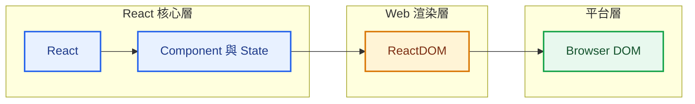
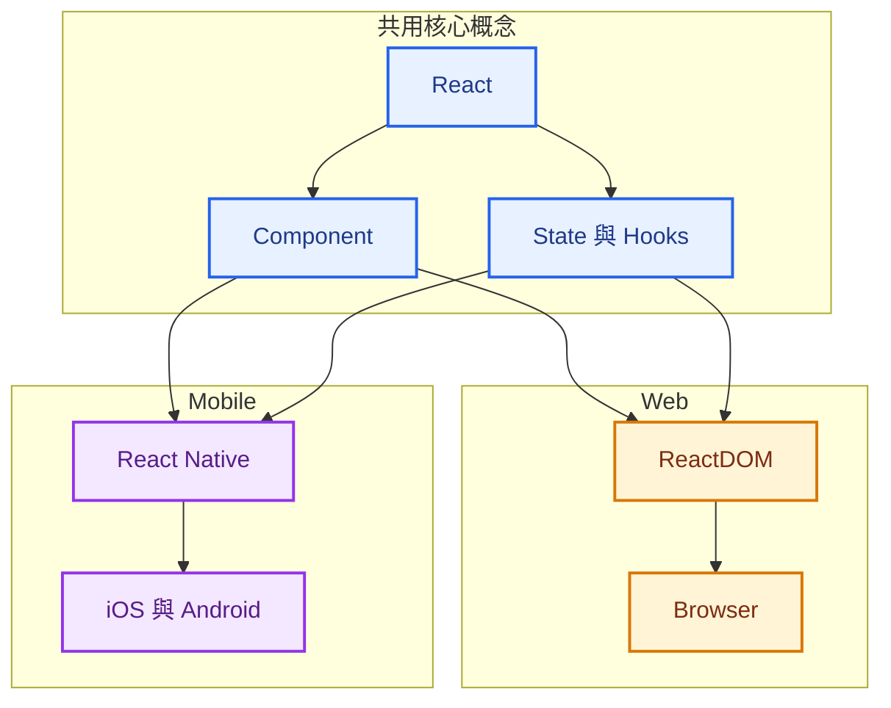
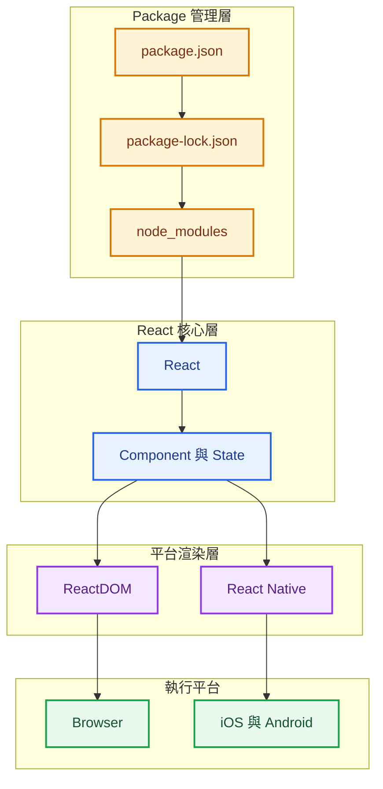

> 預估閱讀時間：約 4 分鐘

## 本篇觀念要點

<Highlight>

React 專案不只是「用了 React」，還需要知道：

**目前使用哪個 React 版本、React 與 ReactDOM 各自負責什麼，以及不同平台如何共用 React 的核心概念。**

</Highlight>

1. [先確認 React Version](#react-version)
2. [React 與 ReactDOM](#react-reactdom)
3. [React 與不同平台](#platform)
4. [版本升級與 npm](#upgrade)
5. [package-lock 與 node_modules](#package-lock)
6. [整體架構](#architecture)
7. [快速複習](#review)

---

## 先確認 React Version {#react-version}

進入既有 React 專案時，可以先從 `package.json` 查看：

```json
"dependencies": {
  "react": "^18.3.1",
  "react-dom": "^18.3.1"
}
```


React 已經發展多年，因此實際工作中可能遇到不同 Major Version：

```text
React 16
React 17
React 18
React 19
```

不同 Major Version 可能伴隨：

* API 與開發 Pattern 改變
* Deprecated API
* Breaking Changes
* 第三方 Library 相容性問題
* Migration 成本

因此版本管理的核心不是：

```text
有新版
→ 馬上升級
```

而是：

```text
確認目前版本
→ 確認升級需求
→ 檢查 Breaking Changes
→ 檢查 Dependencies
→ Migration
→ Test 與 Build
```

---

## React 與 ReactDOM {#react-reactdom}

React 與 ReactDOM 是兩個不同的 Package：

```json
"react": "^18.3.1",
"react-dom": "^18.3.1"
```

可以先建立這個心智模型：

```text
React
→ UI 核心

ReactDOM
→ Web 平台的 Renderer
```

### React

React 負責 UI 的核心抽象。

之後會逐步接觸：

```text
Component
State
Hooks
React Element
UI Composition
```

### ReactDOM

ReactDOM 負責把 React UI 接到 Browser DOM。



核心理解：

> **React 負責描述 UI，ReactDOM 負責把 React 接到 Web Browser。**

---

## React 與不同平台 {#platform}

React 的核心概念不只可以應用在 Browser。

Web Application：

```text
React
→ ReactDOM
→ Browser
```

Mobile Application 則可以透過 React Native：

```text
React
→ React Native
→ iOS / Android
```

React Native 並不是把 HTML 網頁直接塞進手機 App，而是使用 React 的 Component、State、Hooks 等概念建立 Mobile UI。



這也是學習 React 核心值得優先扎穩的原因：

```text
React 核心概念
      ↓
先建立 Web Application
      ↓
未來需要 App 化
      ↓
延伸 React Native
```

我目前先專注 React Web熟練

---

## 版本升級與 npm {#upgrade}

確認目前實際安裝的版本：

```bash
npm list react react-dom
```

可能得到：

```text
react@18.3.1
react-dom@18.3.1
```

如果要指定 React 19：

```bash
npm install react@19 react-dom@19
```

安裝後再確認：

```bash
npm list react react-dom
```

這裡要區分：

```text
package.json
→ 宣告專案需要的 Dependency

npm list
→ 查看目前實際安裝的版本
```

Major Version 升級完成後，真正重要的是驗證 Application：

```text
Upgrade
→ Lint
→ Test
→ Build
→ Run Application
```

> **Package 安裝成功，不代表 Migration 已經成功。**

---

## package-lock 與 node_modules {#package-lock}

這三者可以一起理解：

```text
package.json
→ 專案需要哪些 Packages

package-lock.json
→ Dependency Tree 實際解析的版本

node_modules
→ Packages 實際安裝的位置
```

一般情況：

```text
package.json
        ↓
package-lock.json
        ↓
npm install
        ↓
node_modules
```

其中：

| 項目                  | Git      |
| ------------------- | -------- |
| `package.json`      | Commit   |
| `package-lock.json` | Commit   |
| `node_modules`      | 不 Commit |

正常升級 Package 時，npm 本身會處理 `package-lock.json`。

如果 Dependency Installation 發生異常，可以考慮清除 `node_modules` 後重新安裝；不需要把「每次升級都刪除 package-lock」當成固定流程。

---

## 整體架構 {#architecture}

把目前的 Vite、npm 與 React 串起來：



---

## 快速複習 {#review}

| 問題                   | 核心答案                   |
| -------------------- | ---------------------- |
| React 做什麼？           | UI 核心與 Component 模型    |
| ReactDOM 做什麼？        | 將 React 接到 Browser DOM |
| React Native 做什麼？    | 將 React 概念應用到 Mobile   |
| 哪裡看 Dependency？      | `package.json`         |
| 怎麼確認實際版本？            | `npm list`             |
| Package 實際安裝在哪？      | `node_modules`         |
| Dependency Tree 記在哪？ | `package-lock.json`    |
| Major Upgrade 後做什麼？  | Lint、Test、Build、實際執行   |

:::tip 核心觀念

React 是核心，ReactDOM 是 Web Renderer，React Native 是 Mobile 平台的延伸。

**React 核心 → React Web → 專案實作 → 未來有 App 需求時再延伸 React Native。**

:::
